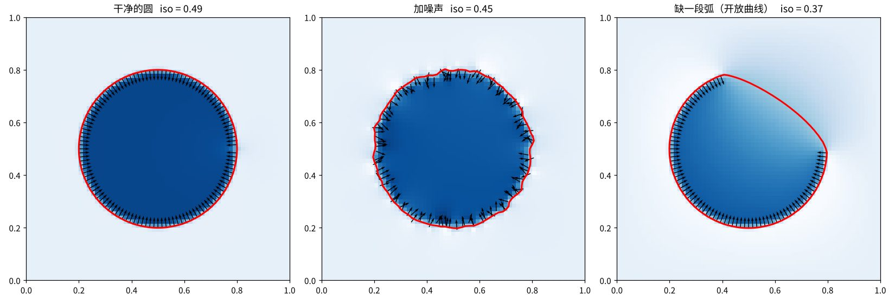

<style>
.post-content{--math:#1F6E8C;--math-soft:#E3EFF4;--eng:#B5651D;--eng-soft:#F7EBDD;--code:#5E4BB0;--code-soft:#ECE8F7;--surface:var(--entry);--line:var(--border);--muted:var(--secondary);--fg:var(--primary);--bg:var(--theme)}
.dark .post-content,:root[data-theme="dark"] .post-content{--math:#5EB4D2;--math-soft:#17303A;--eng:#E39C52;--eng-soft:#3A2A16;--code:#AD95F3;--code-soft:#2A2340}
@media (prefers-color-scheme:dark){:root[data-theme="auto"] .post-content{--math:#5EB4D2;--math-soft:#17303A;--eng:#E39C52;--eng-soft:#3A2A16;--code:#AD95F3;--code-soft:#2A2340}}
.post-content .lanes{display:grid;gap:10px;margin:14px 0 22px}
.post-content .lane{border-left:4px solid var(--line);padding:8px 14px;background:var(--surface);border-radius:0 8px 8px 0}
.post-content .lane .tag{display:inline-block;font-size:11px;letter-spacing:.12em;font-weight:700;margin-right:8px;padding:1px 7px;border-radius:3px;vertical-align:1px}
.post-content .lane p{margin:0}
.post-content .lane.m{border-color:var(--math)} .post-content .lane.m .tag{background:var(--math-soft);color:var(--math)}
.post-content .lane.e{border-color:var(--eng)} .post-content .lane.e .tag{background:var(--eng-soft);color:var(--eng)}
.post-content .lane.c{border-color:var(--code)} .post-content .lane.c .tag{background:var(--code-soft);color:var(--code)}
.post-content figure{margin:18px 0 22px;max-width:100%}
.post-content figure svg{width:100%;height:auto;display:block;max-width:100%}
.post-content figcaption{font-size:.88rem;color:var(--muted);margin-top:8px}
.post-content .fig-img{border:1px solid var(--line);border-radius:8px;max-width:100%}
.post-content .svg-t{font-size:13px;fill:var(--fg)}
.post-content .svg-s{font-size:11.5px;fill:var(--muted)}
.post-content .svg-m{font-family:ui-monospace,Menlo,Consolas,monospace;font-size:12px;fill:var(--fg)}
.post-content .st{stroke:var(--fg);fill:none;stroke-width:1.4}
.post-content .ln{stroke:var(--line);stroke-width:1}
</style>


## 总览

泊松重建要解决的问题是从点云里重建表面．三维扫描、多视角立体匹配或者三维生成模型给出的往往只是一堆离散的采样点，点与点之间没有连接关系，也不构成连续的面，而渲染、编辑、物理仿真都需要一张网格，所以要把这些点变回一张曲面．

- **输入**是一组带法线的点 $\{(s, N_s)\}$．每个点有位置 $s \in \mathbb{R}^3$ 和单位法线 $N_s$，法线可以由扫描设备给出，也可以用邻域点拟合平面估计出来，但所有法线的方向必须一致，本文取朝内．方法不要求点云均匀、完整或没有噪声，只要求法线定向正确．
- **输出**是一张闭合的三角网格 $M = (V, E, F)$．方法并不直接把点连成面，而是先求出定义在整个空间上的指示函数 $\chi$，它在物体内部为 1、外部为 0，再取它的等值面作为曲面．正因为输出来自一个全局定义的函数，重建出的曲面天然闭合，点云里的缺口会被平滑地补上，噪声也会被平均掉．

> 整个方法只有一个想法：找一个函数，让它的梯度尽量等于法线场，然后取它的等值面．原理部分证明这个想法是对的，工程部分把它变成可以算的，代码是工程版去掉八叉树后的最小实现．

<figure>
<svg viewBox="0 0 760 110" role="img" aria-label="泊松重建流程">
  <defs><marker id="ar" viewBox="0 0 10 10" refX="8" refY="5" markerWidth="7" markerHeight="7" orient="auto"><path d="M1 1L8 5L1 9" fill="none" stroke="var(--muted)" stroke-width="1.5" stroke-linecap="round" stroke-linejoin="round"/></marker></defs>
  <g>
    <rect x="5" y="22" width="135" height="64" rx="8" fill="var(--surface)" stroke="var(--line)"/>
    <text class="svg-t" x="72" y="50" text-anchor="middle">带法线的点云</text>
    <text class="svg-s" x="72" y="70" text-anchor="middle">{(s, N_s)}</text>
    <rect x="160" y="22" width="135" height="64" rx="8" fill="var(--math-soft)" stroke="var(--math)"/>
    <text class="svg-t" x="227" y="50" text-anchor="middle">向量场 V</text>
    <text class="svg-s" x="227" y="70" text-anchor="middle">法线摊成场</text>
    <rect x="315" y="22" width="135" height="64" rx="8" fill="var(--math-soft)" stroke="var(--math)"/>
    <text class="svg-t" x="382" y="50" text-anchor="middle">泊松方程</text>
    <text class="svg-s" x="382" y="70" text-anchor="middle">Δχ = ∇·V</text>
    <rect x="470" y="22" width="135" height="64" rx="8" fill="var(--eng-soft)" stroke="var(--eng)"/>
    <text class="svg-t" x="537" y="50" text-anchor="middle">解出 χ</text>
    <text class="svg-s" x="537" y="70" text-anchor="middle">稀疏线性方程组</text>
    <rect x="625" y="22" width="130" height="64" rx="8" fill="var(--surface)" stroke="var(--line)"/>
    <text class="svg-t" x="690" y="50" text-anchor="middle">等值面</text>
    <text class="svg-s" x="690" y="70" text-anchor="middle">marching cubes</text>
    <line x1="140" y1="54" x2="156" y2="54" stroke="var(--muted)" marker-end="url(#ar)"/>
    <line x1="295" y1="54" x2="311" y2="54" stroke="var(--muted)" marker-end="url(#ar)"/>
    <line x1="450" y1="54" x2="466" y2="54" stroke="var(--muted)" marker-end="url(#ar)"/>
    <line x1="605" y1="54" x2="621" y2="54" stroke="var(--muted)" marker-end="url(#ar)"/>
  </g>
</svg>
<figcaption>输入是带法线的点，输出是闭合网格．中间两步是原理，第四步是工程．</figcaption>
</figure>

下文每一步都按三条线写：

<div class="lanes">
  <div class="lane m"><span class="tag">原理</span><p>连续的数学：函数、积分、变分．</p></div>
  <div class="lane e"><span class="tag">工程</span><p>PoissonRecon 怎么把它变成有限个数和一个稀疏矩阵（本文先不含八叉树，按规则网格讲）．</p></div>
  <div class="lane c"><span class="tag">代码</span><p>二维最小实现 <code>poisson2d.py</code> 里对应的变量和行．</p></div>
</div>

## 原理

### 从曲面到指示函数

定义指示函数 $\chi$：物体内部为 1，外部为 0．曲面就是 $\chi$ 的 0.5 等值面．于是“找曲面”变成“找一个函数”．

关键观察：$\chi$ 在内部、外部都是常数，梯度为零；只在曲面处从 0 跳到 1．所以 $\nabla\chi$ 只在曲面上非零，方向沿法线（指向内部），强度是 $\delta$ 函数．曲面的法线场，就是指示函数的梯度场．而点云正好给了法线的采样，所以我们手里有的是 $\nabla\chi$ 的采样．

<figure>
<svg viewBox="0 0 760 215" role="img" aria-label="一维指示函数、平滑后的版本和它的导数">
  <g>
    <text class="svg-s" x="125" y="24" text-anchor="middle">指示函数 χ</text>
    <line class="ln" x1="15" y1="160" x2="240" y2="160"/>
    <polyline class="st" points="20,160 90,160 90,70 170,70 170,160 235,160" stroke="var(--math)"/>
    <text class="svg-m" x="90" y="180" text-anchor="middle">a</text>
    <text class="svg-m" x="170" y="180" text-anchor="middle">b</text>
    <text class="svg-s" x="130" y="62" text-anchor="middle">1</text>
    <text class="svg-s" x="50" y="152" text-anchor="middle">0</text>
  </g>
  <g>
    <text class="svg-s" x="380" y="24" text-anchor="middle">平滑后 χ̃ = χ ∗ F</text>
    <line class="ln" x1="270" y1="160" x2="495" y2="160"/>
    <path class="st" stroke="var(--math)" d="M275 160 C 325 160, 330 70, 350 70 L 415 70 C 435 70, 440 160, 490 160"/>
    <text class="svg-m" x="345" y="180" text-anchor="middle">a</text>
    <text class="svg-m" x="425" y="180" text-anchor="middle">b</text>
  </g>
  <g>
    <text class="svg-s" x="635" y="24" text-anchor="middle">导数 χ̃′ = F(x−a) − F(x−b)</text>
    <line class="ln" x1="525" y1="115" x2="750" y2="115"/>
    <path class="st" stroke="var(--eng)" d="M570 115 Q600 30 630 115"/>
    <path class="st" stroke="var(--eng)" d="M650 115 Q680 200 710 115"/>
    <text class="svg-m" x="600" y="135" text-anchor="middle">a</text>
    <text class="svg-m" x="680" y="100" text-anchor="middle">b</text>
    <text class="svg-s" x="600" y="48" text-anchor="middle">+ 内法线朝右</text>
    <text class="svg-s" x="680" y="205" text-anchor="middle">− 内法线朝左</text>
  </g>
</svg>
<figcaption>一维版本．物体是区间 [a, b]．台阶的导数是两个 δ 尖，平滑后变成两个鼓包；鼓包的符号就是该边界点的“内法线”方向．</figcaption>
</figure>

<div class="lanes">
  <div class="lane e"><span class="tag">工程</span><p>法线方向必须一致（都朝内或都朝外）．这是唯一的前置要求，PoissonRecon 不做定向，靠上游．一半翻了，$V$ 就不是任何函数的梯度．</p></div>
  <div class="lane c"><span class="tag">代码</span><p><code>N = -np.stack([cos t, sin t], 1)</code>，负号让法线朝内．全部去掉负号等价于内外互换，曲面不变；只翻一半才会坏．</p></div>
</div>

### 平滑与梯度公式

$\chi$ 不连续，梯度是分布，没法数值处理．用一个平滑核 $F$（积分为 1 的紧支撑鼓包）卷一下，记 $\tilde\chi = \chi * F$．卷积的定义本身就把两个角色分开了：

$$
(\chi * F)(q) = \int \chi(p)\,F(q-p)\,dp = \int_M F(q-p)\,dp
$$

- $q$：评估点，“现在正在算哪一点”．最后 $\tilde\chi(q)$、$V(q)$ 都是 $q$ 的函数．
- $p$：积分变量．一开始跑遍物体内部 $M$，用了散度定理之后只跑遍表面 $\partial M$．

直观意义：以 $q$ 为中心放一个鼓包 $F$，看它罩住了多少物体体积．深处内部 ≈ 1，远处外部 ≈ 0，表面附近是中间值．

对它求梯度：

$$
\nabla\tilde\chi(q) = \int_M \nabla_q F(q-p)\,dp = -\int_M \nabla_p F(q-p)\,dp = \oint_{\partial M} F(q-p)\,N_{in}(p)\,dp
$$

三个等号分别是三件事：

1. 导数穿进积分．积分是对 $p$ 做的，$q$ 只是参数，区域 $M$ 与 $q$ 无关，可以交换顺序．把积分想成对很多小方块求和，“和的导数 = 导数的和”．
2. 对 $q$ 求导等于负的对 $p$ 求导．$F$ 吃的是差值 $q-p$，链式法则：$\partial_{q_x}F(q-p) = F_x\cdot(+1)$，$\partial_{p_x}F(q-p) = F_x\cdot(-1)$．换成对积分变量求导，才能用下一条．
3. 体积分变面积分．散度定理（梯度形式）$\int_M \nabla g\,dp = \oint_{\partial M} g\,N_{out}\,dp$，取 $g = F(q-p)$．负号把外法线翻成内法线．

> 一维的对照是牛顿-莱布尼茨公式 $\int_a^b g'(p)\,dp = g(b)\cdot(+1) + g(a)\cdot(-1)$，它可以读成“对边界点求和，每点乘上外法线”（$b$ 处外法线 +1，$a$ 处 −1）．散度定理就是它的三维版：边界从两个点变成一张面，±1 变成法线向量．

不用散度定理，用几何也能看出来：梯度的 x 分量是“把 $q$ 右移 $h$，$\tilde\chi$ 变了多少，除以 $h$”．鼓包右移 $h$ 等价于物体左移 $h$．左移后的物体和原物体几乎重合，差别只在表面：左侧多出一层薄壳，右侧少掉一层．壳的厚度是 $h\,|N_x|$（正对 x 方向厚 $h$，平行于 x 方向厚 0）．变化量 = 左侧薄壳里 $F$ 的积分 − 右侧薄壳里的，除以 $h$ 就是 $\oint F(q-p)\,N_{in,x}\,dS$．内部完全抵消，所以只剩表面积分．

<figure>
<svg viewBox="0 0 680 330" role="img" aria-label="把物体左移 h 后，加权体积的变化只来自表面薄壳">
  <path d="M280 91 A150 110 0 1 0 280 309 A150 110 0 0 1 280 91 Z" fill="var(--math)" opacity="0.35"/>
  <path d="M280 91 A150 110 0 1 1 280 309 A150 110 0 0 0 280 91 Z" fill="var(--eng)" opacity="0.4"/>
  <ellipse cx="300" cy="200" rx="150" ry="110" fill="none" stroke="var(--fg)" stroke-width="1.3"/>
  <ellipse cx="260" cy="200" rx="150" ry="110" fill="none" stroke="var(--fg)" stroke-width="1" stroke-dasharray="5 4"/>
  <circle cx="170" cy="140" r="55" fill="var(--eng)" opacity="0.18"/>
  <circle cx="170" cy="140" r="55" fill="none" stroke="var(--eng)" stroke-width="0.9" stroke-dasharray="3 3"/>
  <circle cx="170" cy="140" r="3" fill="var(--fg)"/>
  <text class="svg-m" x="180" y="132">q</text>
  <line x1="330" y1="60" x2="272" y2="60" stroke="var(--muted)" marker-end="url(#ar)"/>
  <text class="svg-s" x="300" y="46" text-anchor="middle">把物体左移 h</text>
  <line x1="150" y1="200" x2="118" y2="200" stroke="var(--math)" stroke-width="1.6" marker-end="url(#ar)"/>
  <line x1="450" y1="200" x2="484" y2="200" stroke="var(--eng)" stroke-width="1.6" marker-end="url(#ar)"/>
  <text class="svg-s" x="470" y="110" text-anchor="start">实线：原来的物体</text>
  <text class="svg-s" x="470" y="130" text-anchor="start">虚线：左移 h 之后</text>
  <text class="svg-s" x="470" y="160" text-anchor="start" fill="var(--math)">左侧多出的薄壳：χ̃ 增加</text>
  <text class="svg-s" x="470" y="180" text-anchor="start" fill="var(--eng)">右侧少掉的薄壳：χ̃ 减少</text>
  <text class="svg-s" x="470" y="210" text-anchor="start">箭头：外法线方向</text>
  <text class="svg-s" x="470" y="240" text-anchor="start">圆：以 q 为中心的鼓包 F</text>
</svg>
<figcaption>薄壳只在表面；最上和最下两点壳厚为 0，这就是 |N_x| 因子的来源．</figcaption>
</figure>

### 从点云到向量场 V

走完上一节，$p$ 只跑遍表面．要算 $q$ 处的梯度，不需要知道物体内部长什么样，只需要知道表面在哪、法线朝哪，而这正是点云给的东西．把曲面积分换成对采样点求和，每个点代表一小块面积 $|P_s|$：

$$
V(q) = \sum_s |P_s|\,F(q-s)\,N_s
$$

读法：站在 $q$ 处问“这里的梯度该是多少”，附近的采样点各自按距离权重 $F(q-s)$ 投票，票的内容是自己的法线．远处的点 $F$ 很小，几乎不投票．

<div class="lanes">
  <div class="lane e"><span class="tag">工程</span><p>要把 $V$ 存成网格上的数，就在每个节点 $o$ 记 $V(c_o)$，等价于把每个样本的法线乘 $|P_s|$，按三线性权重摊给周围 8 个节点．$|P_s|$ 由局部采样密度估计，见“摊法线”一节．</p></div>
  <div class="lane c"><span class="tag">代码</span><p><code>splat_normals</code>：<code>area</code> 是 $|P_s|$，<code>/h**2</code> 归一化 $F$，双线性权重摊给 4 个角．</p></div>
</div>

### 为什么是最小二乘

想求 $\chi$ 使 $\nabla\chi = V$．但梯度场有个硬性质：旋度为零，$\nabla\times\nabla\chi = 0$．而 $V$ 是把带噪声的法线按鼓包摊开再叠加出来的，一般 $\nabla\times V \neq 0$，方程无解．

<figure style="max-width:260px">
<svg viewBox="0 0 220 220" role="img" aria-label="纯旋转向量场">
  <circle cx="110" cy="110" r="70" fill="none" stroke="var(--line)" stroke-dasharray="3 3"/>
  <g stroke="var(--math)" stroke-width="1.6" marker-end="url(#ar)">
    <line x1="180" y1="98" x2="180" y2="122"/>
    <line x1="122" y1="180" x2="98" y2="180"/>
    <line x1="40" y1="122" x2="40" y2="98"/>
    <line x1="98" y1="40" x2="122" y2="40"/>
    <line x1="168" y1="151" x2="151" y2="168"/>
    <line x1="69" y1="168" x2="52" y2="151"/>
    <line x1="52" y1="69" x2="69" y2="52"/>
    <line x1="151" y1="52" x2="168" y2="69"/>
  </g>
  <text class="svg-s" x="110" y="115" text-anchor="middle">V = (−y, x)</text>
</svg>
<figcaption>沿它走一圈回到原点，“函数值”却一直在涨．没有任何函数的梯度长这样．</figcaption>
</figure>

无解时做最小二乘，和 $Ax=b$ 无解时解 $\min\|Ax-b\|^2$ 是一回事：找梯度最接近 $V$ 的函数．

$$
\min_{\chi}\int\|\nabla\chi - V\|^2
$$

这一步也是方法对噪声鲁棒的来源：任何向量场可以拆成“梯度部分 + 旋转部分”，最小二乘只保留能被梯度解释的部分，噪声带来的旋转成分被自动扔掉．

### 从变分法到泊松方程

最快的看法是正规方程．有限维里 $\min_x\|Ax-b\|^2$ 的解满足 $A^\top A x = A^\top b$．这里 $A = \nabla$，而 $\nabla$ 的转置是 $-\nabla\cdot$（下面会证）．代进去：

$$
(-\nabla\cdot)(\nabla\chi) = (-\nabla\cdot)V \;\Longrightarrow\; \Delta\chi = \nabla\cdot V
$$

下面逐步推导．$E$ 的输入是函数、输出是数，没法直接“对函数求导”．办法：固定一个方向 $\eta$（也是函数，边界处为零），只看沿这个方向走的一条线：

$$
g(\varepsilon) = E(\chi^* + \varepsilon\eta)
$$

$g$ 是 $\mathbb{R}\to\mathbb{R}$ 的普通函数．逻辑链：

1. 假设 $\chi^*$ 是最小值点（这是前提，不是推出来的；$\chi^*$ 是未知数，先给它起个名字）．
2. 所以沿任何方向走出去 $E$ 都不变小，每条线上 $g$ 在 $\varepsilon=0$ 处取最小值．
3. 一元函数在内点取最小值，导数为零：$g'(0)=0$．注意是先把 $g$ 当 $\varepsilon$ 的函数求导，再代 $\varepsilon = 0$．

> 有限维的对照是 $f(x,y) = (x-1)^2 + (y-2)^2$．设最小值点 $(x^*,y^*)$，任取方向 $d$，$g(\varepsilon) = f(x^*+\varepsilon d_1, y^*+\varepsilon d_2)$，$g'(0) = 2(x^*-1)d_1 + 2(y^*-2)d_2 = 0$ 对所有 $d$．取 $d=(1,0)$ 得 $x^*=1$，取 $d=(0,1)$ 得 $y^*=2$．“对所有方向 $g'(0)=0$” 和 “每个偏导为零” 是一句话．在非最小值点（比如 $(0,0)$、$d=(1,0)$），$g(\varepsilon) = \varepsilon^2 - 2\varepsilon + 5$，$g'(0) = -2 \neq 0$．

把 $g(\varepsilon)$ 算出来．$\nabla$ 是线性的，$\varepsilon$ 是常数：

$$
g(\varepsilon) = \int\|\nabla\chi^* + \varepsilon\nabla\eta - V\|^2 = \underbrace{\int\|\nabla\chi^*-V\|^2}_{A} + 2\varepsilon\underbrace{\int(\nabla\chi^*-V)\cdot\nabla\eta}_{B} + \varepsilon^2\underbrace{\int\|\nabla\eta\|^2}_{C}
$$

一条抛物线，$g'(0) = 2B$，极值条件就是 $B = 0$．接下来把 $\eta$ 上的 $\nabla$ 挪走．乘积法则 $\nabla\cdot(\eta W) = \nabla\eta\cdot W + \eta\,\nabla\cdot W$，两边积分，左边由散度定理变成边界积分，而 $\eta$ 在边界为 0，所以

$$
\int\nabla\eta\cdot W = -\int\eta\,(\nabla\cdot W)
$$

这就是“$\nabla$ 的转置是 $-\nabla\cdot$”．取 $W = \nabla\chi^* - V$：

$$
-\int\eta\,(\Delta\chi^* - \nabla\cdot V) = 0 \quad\text{对所有 }\eta
$$

一个函数和所有 $\eta$ 的积分都为零，它只能恒为零（否则在它为正的地方放一个小鼓包当 $\eta$，积分大于零）．所以 $\Delta\chi^* = \nabla\cdot V$．星号去掉，这就是要解的泊松方程．

这就是最标准的变分法：先写出泛函，再加扰动取一阶项，也就是“变分”，然后分部积分，得到 Euler-Lagrange 方程．套通用公式 $\partial L/\partial\chi - \nabla\cdot\big(\partial L/\partial(\nabla\chi)\big) = 0$，$L = \|\nabla\chi - V\|^2$，得到同一个结果．

## 工程化

工程对原理只做了四件事：把函数换成系数向量，把积分换成查表求和，把曲面积分换成对样本求和，把解方程换成解稀疏线性系统．这一节按规则网格讲，分辨率 $2^D$，间距 $w = 2^{-D}$，也就是八叉树全部细分到底的退化情形．

### 基函数与未知数

连续的 $\chi$ 有无穷多自由度．限定它只能是有限个基函数的线性组合：

$$
\tilde\chi(q) = \sum_o x_o\,F_o(q), \qquad F_o(q) = F\!\left(\frac{q-c_o}{w}\right)
$$

每个网格节点 $o$ 挂一个基函数，是同一个母函数 $F$ 平移到节点中心 $c_o$、缩放到节点大小 $w$．未知数就是系数向量 $x$，节点数、基函数数、未知数个数三者相等．

<figure style="max-width:460px">
<svg viewBox="0 0 400 150" role="img" aria-label="帽子函数与二次 B 样条">
  <line class="ln" x1="30" y1="120" x2="370" y2="120"/>
  <g class="svg-s" text-anchor="middle">
    <text x="40" y="138">−2</text><text x="120" y="138">−1</text><text x="200" y="138">0</text><text x="280" y="138">1</text><text x="360" y="138">2</text>
  </g>
  <polyline points="120,120 200,30 280,120" fill="none" stroke="var(--code)" stroke-width="1.8"/>
  <polyline points="80,120 100,117 120,108.8 140,94.7 160,75 180,58 200,52.5 220,58 240,75 260,94.7 280,108.8 300,117 320,120" fill="none" stroke="var(--eng)" stroke-width="1.8"/>
  <text class="svg-s" x="212" y="24" fill="var(--code)">帽子（代码）</text>
  <text class="svg-s" x="300" y="70" fill="var(--eng)">二次 B 样条（PoissonRecon）</text>
</svg>
<figcaption>横轴单位是网格间距．帽子支撑宽 2，分段线性；二次 B 样条支撑宽 3，分段二次，一阶导连续．</figcaption>
</figure>

<div class="lanes">
  <div class="lane e"><span class="tag">工程</span><p>$F$ 取 box filter 自卷积 3 次，得二次 B 样条（PoissonRecon 默认 <code>degree 2</code>）．理由：它就是推导里用来平滑的那个核，理论和实现用的是同一个 $F$；支撑紧，节点离远了不重叠，矩阵稀疏；分段多项式，内积有闭式；所有 $F_o$ 是同一函数的平移缩放，内积只和相对位置有关，可以打表．</p></div>
  <div class="lane c"><span class="tag">代码</span><p>帽子函数 <code>hat(q,i,j) = max(0, 1−|q_x/h − i|) · max(0, 1−|q_y/h − j|)</code>．代码里没显式写，藏在四处：<code>splat_normals</code> 的双线性权重就是帽子在样本点处的值；<code>G</code> 的差分就是帽子组合的斜率；<code>map_coordinates(order=1)</code> 就是 $\sum x_o F_o(q)$；<code>find_contours</code> 假设格内线性．</p></div>
</div>

### 摊法线

样本 $s$ 落在某个格子里，它的法线乘 $|P_s|$，按到各角点的距离（三线性权重）分给 8 个角点．点越靠近哪个角，哪个角拿得越多，权重之和为 1．这个权重恰好等于角点基函数在 $s$ 处的值 $F_o(s)$，所以摊法线就是在把 $V$ 也用这组基函数表示出来．

<figure style="max-width:360px">
<svg viewBox="0 0 320 230" role="img" aria-label="一个样本点把法线按双线性权重分给格子的四个角">
  <rect x="70" y="40" width="160" height="160" fill="var(--surface)" stroke="var(--line)"/>
  <g stroke="var(--muted)" stroke-dasharray="3 3">
    <line x1="170" y1="110" x2="70" y2="200"/><line x1="170" y1="110" x2="230" y2="200"/>
    <line x1="170" y1="110" x2="70" y2="40"/><line x1="170" y1="110" x2="230" y2="40"/>
  </g>
  <circle cx="70" cy="200" r="5" fill="var(--math)"/><circle cx="230" cy="200" r="5" fill="var(--math)"/>
  <circle cx="70" cy="40" r="5" fill="var(--math)"/><circle cx="230" cy="40" r="5" fill="var(--math)"/>
  <circle cx="170" cy="110" r="4" fill="var(--eng)"/>
  <line x1="170" y1="110" x2="146" y2="92" stroke="var(--eng)" stroke-width="1.8" marker-end="url(#ar)"/>
  <text class="svg-m" x="178" y="124">s</text>
  <text class="svg-s" x="66" y="222" text-anchor="middle">(1−f_x)(1−f_y) = 0.16</text>
  <text class="svg-s" x="236" y="222" text-anchor="middle">f_x(1−f_y) = 0.27</text>
  <text class="svg-s" x="66" y="28" text-anchor="middle">(1−f_x)f_y = 0.21</text>
  <text class="svg-s" x="236" y="28" text-anchor="middle">f_x f_y = 0.35</text>
  <line x1="70" y1="212" x2="170" y2="212" stroke="var(--muted)"/><text class="svg-s" x="120" y="209" text-anchor="middle">f_x</text>
  <line x1="242" y1="200" x2="242" y2="110" stroke="var(--muted)"/><text class="svg-s" x="255" y="158">f_y</text>
</svg>
<figcaption>二维版：f_x、f_y 是样本在格子内的相对位置，四个权重分别是帽子基函数在 s 处的值．</figcaption>
</figure>

再看每个点代表多大面积．$|P_s|$ 是样本代表的那一小片曲面的面积，密的地方小、稀的地方大．工程做法：先估局部密度 $W(s) = \sum_{s'}F(s-s')$（把所有点以单位权重摊到网格上，再在 $s$ 处取值），然后 $|P_s|\propto 1/W(s)$．这样密集区不会因为点多而压过稀疏区．

<div class="lanes">
  <div class="lane c"><span class="tag">代码</span><p>密度没做，采样均匀，直接用解析弧长 <code>2πr/n</code>．要加的话：同样的循环只累加权重不乘法线，得密度图 <code>W</code>；<code>w_s = map_coordinates(W, P/h)</code>；<code>area_s = 1/w_s</code>．</p></div>
</div>

### 矩阵 L 与右端 b

把 $\tilde\chi = \sum_o x_o F_o$ 代进能量．积分是对位置 $q$ 做的，$F_o$ 和 $V$ 都是已知函数，所以每个积分算完是一个数；未知数 $x_o$ 是常数，提到积分外．两个基函数的情况：

$$
E(x_1,x_2) = L_{11}x_1^2 + 2L_{12}x_1x_2 + L_{22}x_2^2 - 2b_1x_1 - 2b_2x_2 + c
$$

$$
L_{oo'} = \int\nabla F_o\cdot\nabla F_{o'}, \qquad b_o = \int\nabla F_o\cdot V
$$

这是普通的二次函数．对 $x_1$、$x_2$ 求偏导置零，就是 $Lx = b$．推广到 $n$ 个基函数，$L$ 是 $n\times n$，每行一个方程．

> 和连续版的关系是，把 $\Delta\tilde\chi = \nabla\cdot V$ 两边和每个 $F_o$ 做内积再分部积分，得到的是同一个 $Lx=b$（Galerkin 方法）．“能量对系数求导置零”和“方程在这组基上投影”是一回事．

再看 $L$ 为什么能算、为什么稀疏．两个鼓包不重叠，被积函数处处为零，$L_{oo'}=0$．所有 $F_o$ 是同一个 $F$ 的平移，换元 $u = q - c_o$：

$$
L_{oo'} = \int\nabla F(u)\cdot\nabla F\big(u-(c_{o'}-c_o)\big)\,du
$$

只依赖中心差 $d = c_{o'} - c_o$，而 $d$ 是整数向量．二次 B 样条支撑宽 3，$|d_x|,|d_y|,|d_z|\le 2$ 才重叠，$d$ 只有 $5^3 = 125$ 种．算 125 个数存起来，建 $L$ 时每行按邻居相对位置查这张表．

三维积分可以拆成一维．B 样条是张量积 $F(u) = f(u_x)f(u_y)f(u_z)$，于是

$$
\int\partial_xF(u)\,\partial_xF(u-d)\,du = \underbrace{\int f'(t)f'(t-d_x)\,dt}_{c(d_x)}\cdot\underbrace{\int f(t)f(t-d_y)\,dt}_{a(d_y)}\cdot a(d_z)
$$

$$
L_{oo'} = c(d_x)a(d_y)a(d_z) + a(d_x)c(d_y)a(d_z) + a(d_x)a(d_y)c(d_z)
$$

真正要算的只有两个一维函数 $a(d)$、$c(d)$ 在 $d\in\{-2,\dots,2\}$ 的值，各 5 个数，分段多项式的积分，闭式．

右端 $b$ 的来源是，“摊法线”一节把 $V$ 摊到了节点上，意思是 $V(q) = \sum_{o'}V_{o'}F_{o'}(q)$．代进去：

$$
b_o = \sum_{o'} V_{o'}\cdot\int\nabla F_o\,F_{o'}\,dq
$$

里面的积分是一个三维向量，同样只依赖 $d$、同样按张量积拆成一维（x 分量是 $\int f'(t)f(t-d_x)\,dt\cdot a(d_y)a(d_z)$）．第二张表，125 项．$b_o$ 就是对 125 个邻居，节点向量点乘查表向量，求和．

<figure style="max-width:300px">
<svg viewBox="0 0 260 260" role="img" aria-label="五点拉普拉斯模板">
  <g stroke="var(--line)"><line x1="50" y1="130" x2="210" y2="130"/><line x1="130" y1="50" x2="130" y2="210"/></g>
  <g fill="var(--surface)" stroke="var(--line)"><circle cx="50" cy="50" r="16"/><circle cx="210" cy="50" r="16"/><circle cx="50" cy="210" r="16"/><circle cx="210" cy="210" r="16"/></g>
  <g fill="var(--math-soft)" stroke="var(--math)"><circle cx="50" cy="130" r="18"/><circle cx="210" cy="130" r="18"/><circle cx="130" cy="50" r="18"/><circle cx="130" cy="210" r="18"/></g>
  <circle cx="130" cy="130" r="20" fill="var(--math)"/>
  <g class="svg-m" text-anchor="middle" dominant-baseline="central">
    <text x="130" y="130" fill="var(--bg)">4</text>
    <text x="50" y="130">−1</text><text x="210" y="130">−1</text><text x="130" y="50">−1</text><text x="130" y="210">−1</text>
    <text x="50" y="50" fill="var(--muted)">0</text><text x="210" y="50" fill="var(--muted)">0</text><text x="50" y="210" fill="var(--muted)">0</text><text x="210" y="210" fill="var(--muted)">0</text>
  </g>
  <text class="svg-s" x="130" y="248" text-anchor="middle">L 的一行（乘 h²），帽子基函数</text>
</svg>
<figcaption>代码打印出的 <code>[-1,-1,4,-1,-1]</code>．中心节点在 4 条边上，每条边贡献 1/h²；和邻居共享一条边，贡献 −1/h²．一维例子里对应 (−1, 2, −1)．</figcaption>
</figure>

<div class="lanes">
  <div class="lane c"><span class="tag">代码</span><p><code>G = gradient_operator(...)</code> 每条边一行，右节点 <code>+1/h</code>、左节点 <code>−1/h</code>，<code>G @ chi</code> 就是所有边上的梯度．<code>L = Gf.T @ Gf</code> 不查表直接乘出来，$(G^\top G)_{oo'} = \sum_e G_{eo}G_{eo'}$，只有同时含 $o,o'$ 的边才贡献．<code>b = Gf.T @ v</code>：$(G^\top v)_{ij} = (v_左 - v_右)/h + (v_下 - v_上)/h = -\nabla\cdot V$．于是 <code>L x = b</code> 就是 $-\Delta\chi = -\nabla\cdot V$．</p></div>
</div>

### 边界条件

方程要在一个有界的盒子里解（包围盒放大 1.1 倍，`--scale`），盒子边上必须说清 $\chi$ 怎么样，否则方程不定．

<figure style="max-width:560px">
<svg viewBox="0 0 520 220" role="img" aria-label="Dirichlet 与 Neumann 边界条件下的重建结果">
  <rect x="10" y="20" width="220" height="180" fill="var(--surface)" stroke="var(--line)"/>
  <path d="M60 120 A60 45 0 0 0 180 120" fill="var(--math-soft)" stroke="var(--math)" stroke-width="1.6"/>
  <path d="M60 120 A60 45 0 0 1 180 120" fill="var(--math-soft)" stroke="var(--math)" stroke-width="1.4" stroke-dasharray="4 3"/>
  <text class="svg-s" x="120" y="40" text-anchor="middle">Dirichlet：边界上 χ = 0</text>
  <text class="svg-s" x="120" y="190" text-anchor="middle">内部必须是有界的团，一定封闭</text>
  <rect x="290" y="20" width="220" height="180" fill="var(--surface)" stroke="var(--line)"/>
  <path d="M290 115 Q400 60 510 115 L510 200 L290 200 Z" fill="var(--math-soft)" stroke="none"/>
  <path d="M340 90 Q400 60 460 90" fill="none" stroke="var(--math)" stroke-width="1.6"/>
  <path d="M290 115 Q315 100 340 90" fill="none" stroke="var(--math)" stroke-width="1.4" stroke-dasharray="4 3"/>
  <path d="M460 90 Q485 100 510 115" fill="none" stroke="var(--math)" stroke-width="1.4" stroke-dasharray="4 3"/>
  <text class="svg-s" x="400" y="40" text-anchor="middle">Neumann：边界上 ∂χ/∂n = 0</text>
  <text class="svg-s" x="400" y="190" text-anchor="middle">内部可以延伸到盒子边，被盒子截断</text>
</svg>
<figcaption>实线是有数据的部分，虚线是求解器补出来的部分．</figcaption>
</figure>

- **Dirichlet**：盒子边界上 $\chi = 0$．边界节点不是未知数，值定死为 0．后果：曲面一定封闭．
- **Neumann**：边界上法向导数为 0．边界节点也是未知数，没有条件钉住 $\chi$ 的整体高度，$\chi + C$ 也是解，$L$ 奇异（零空间是常数向量，因为 $G\mathbf{1} = 0$）．求解时固定一个节点，或用共轭梯度（$b$ 自动和常数正交：$\mathbf{1}^\top G^\top v = (G\mathbf{1})^\top v = 0$）．后果：开放扫描的曲面被盒子截断，而不是封成气泡．PoissonRecon 默认 Neumann（`--bType`）．

<div class="lanes">
  <div class="lane c"><span class="tag">代码</span><p><code>interior</code> 掩码 + <code>Gf = G[:, free]</code> 删掉边界节点的列，就是 Dirichlet．改 Neumann：不删列，<code>L = G.T @ G</code>，<code>spla.cg(L, b)</code>；解差一个常数，等值从样本均值取，常数自动抵消．</p></div>
</div>

### 求解

<div class="lanes">
  <div class="lane e"><span class="tag">工程</span><p>$L$ 对称半正定稀疏，百万维．拉普拉斯算子全局耦合：细网格上的迭代（高斯-赛德尔、共轭梯度）只能快速消掉局部高频误差，整体形状这种低频误差要迭代极多次．所以用多重网格：先在粗网格解整体形状，把粗解的贡献从细网格右端项减掉，细网格只解剩下的局部修正，几次迭代就够．2013 版用 cascadic multigrid．</p></div>
  <div class="lane c"><span class="tag">代码</span><p><code>spla.spsolve(L, b)</code>，直接稀疏 LU，四千维够用．</p></div>
</div>

### 等值面与 marching cubes

先看等值取多少．离散后 $\tilde\chi$ 不严格在 0 到 1，0.5 不一定准．样本点本该在曲面上，所以取 $\tilde\chi$ 在所有样本处的（加权）平均．代码跑出来 0.49．

再看 marching cubes．它输入每个角点上的 $\tilde\chi$ 和等值 $c$，输出三角形．逐格处理：8 个角各标“内”（$\tilde\chi > c$）或“外”，共 $2^8 = 256$ 种组合（按对称性 15 种本质情形）．每种组合预先定好曲面穿过哪几条边、穿越点连成哪几个三角形．穿越点在边上线性插值：$t = (c-\chi_a)/(\chi_b-\chi_a)$．相邻格子共享边，同一条边算出的穿越点一样，三角形自动拼接，不需要缝合．

<figure>
<svg viewBox="0 0 760 180" role="img" aria-label="marching squares 的四种情形">
  <g>
    <rect x="40" y="40" width="100" height="100" fill="var(--surface)" stroke="var(--line)"/>
    <circle cx="40" cy="140" r="6" fill="var(--math)"/><circle cx="140" cy="140" r="6" fill="var(--surface)" stroke="var(--muted)"/>
    <circle cx="40" cy="40" r="6" fill="var(--surface)" stroke="var(--muted)"/><circle cx="140" cy="40" r="6" fill="var(--surface)" stroke="var(--muted)"/>
    <line x1="40" y1="100" x2="80" y2="140" stroke="var(--eng)" stroke-width="2"/>
    <text class="svg-s" x="90" y="168" text-anchor="middle">1 个角在内</text>
  </g>
  <g>
    <rect x="220" y="40" width="100" height="100" fill="var(--surface)" stroke="var(--line)"/>
    <circle cx="220" cy="140" r="6" fill="var(--math)"/><circle cx="320" cy="140" r="6" fill="var(--math)"/>
    <circle cx="220" cy="40" r="6" fill="var(--surface)" stroke="var(--muted)"/><circle cx="320" cy="40" r="6" fill="var(--surface)" stroke="var(--muted)"/>
    <line x1="220" y1="85" x2="320" y2="95" stroke="var(--eng)" stroke-width="2"/>
    <text class="svg-s" x="270" y="168" text-anchor="middle">相邻 2 个角在内</text>
  </g>
  <g>
    <rect x="400" y="40" width="100" height="100" fill="var(--surface)" stroke="var(--line)"/>
    <circle cx="400" cy="140" r="6" fill="var(--math)"/><circle cx="500" cy="140" r="6" fill="var(--math)"/>
    <circle cx="400" cy="40" r="6" fill="var(--math)"/><circle cx="500" cy="40" r="6" fill="var(--surface)" stroke="var(--muted)"/>
    <line x1="455" y1="40" x2="500" y2="90" stroke="var(--eng)" stroke-width="2"/>
    <text class="svg-s" x="450" y="168" text-anchor="middle">3 个角在内</text>
  </g>
  <g>
    <rect x="580" y="40" width="100" height="100" fill="var(--surface)" stroke="var(--line)"/>
    <circle cx="580" cy="140" r="6" fill="var(--math)"/><circle cx="680" cy="40" r="6" fill="var(--math)"/>
    <circle cx="580" cy="40" r="6" fill="var(--surface)" stroke="var(--muted)"/><circle cx="680" cy="140" r="6" fill="var(--surface)" stroke="var(--muted)"/>
    <line x1="580" y1="90" x2="630" y2="140" stroke="var(--eng)" stroke-width="2"/>
    <line x1="630" y1="40" x2="680" y2="90" stroke="var(--eng)" stroke-width="2"/>
    <line x1="580" y1="90" x2="630" y2="40" stroke="var(--eng)" stroke-width="1.2" stroke-dasharray="3 3"/>
    <line x1="630" y1="140" x2="680" y2="90" stroke="var(--eng)" stroke-width="1.2" stroke-dasharray="3 3"/>
    <text class="svg-s" x="630" y="168" text-anchor="middle">对角：有歧义</text>
  </g>
  <text class="svg-s" x="20" y="22">实心角 = 内（χ̃ &gt; c）；穿越点按边上线性插值</text>
</svg>
<figcaption>二维版叫 marching squares：4 个角、16 种组合、输出线段．<code>find_contours</code> 做的就是这个．对角情形有两种连法，需要额外规则．</figcaption>
</figure>

<div class="lanes">
  <div class="lane e"><span class="tag">工程</span><p>八叉树里相邻格子大小不同，粗格子一条边对应细格子两条边，穿越点不一致会出裂缝，PoissonRecon 有自己的八叉树版本处理．规则网格下没有这个问题．</p></div>
  <div class="lane c"><span class="tag">代码</span><p><code>map_coordinates(chi, P/h, order=1).mean()</code> 取等值；<code>measure.find_contours(chi, iso)</code> 抽线，结果乘 <code>h</code> 换回坐标．</p></div>
</div>

### Screened 项

泊松方程只约束梯度，没有直接要求曲面穿过样本点，曲面可以整体偏移、细节被抹平．改法是在能量里加位置项，要求 $\chi$ 在样本处取等值面的值（原文把约定改成曲面处为 0）：

$$
E(\chi) = \int\|\nabla\chi - V\|^2 + \frac{\alpha}{|P|}\sum_p w_p\,\chi(p)^2
$$

方程从 $\Delta\chi = \nabla\cdot V$ 变成带零阶项的 $\Delta\chi - \alpha(\cdot)\chi = \nabla\cdot V$，物理里叫 screened Poisson 方程，名字由此而来．

<div class="lanes">
  <div class="lane e"><span class="tag">工程</span><p>代入基函数，这一项是 $x^\top P x$，$P_{oo'} = \sum_p w_p F_o(p)F_{o'}(p)$，只有样本附近的节点非零．方程变 $(L+\alpha P)x = b$，求解器不变．$\alpha$ 另乘一个随 $D$ 变的系数，使作用强度不随分辨率变．<code>--pointWeight</code> 默认 4．</p></div>
  <div class="lane c"><span class="tag">代码</span><p>没做．按代码“内 1 外 0、曲面 0.5”的约定，等价于罚 $(\chi(p)-0.5)^2$：<code>W</code> 是“在样本点处插值”的矩阵（行是样本，列是节点，元素是帽子值），<code>L2 = L + alpha*(W.T@W)</code>，<code>b2 = b + alpha*0.5*(W.T@ones)</code>．</p></div>
</div>

### 八叉树在哪

八叉树就是下标 $o$ 的来源．节点的中心 $c_o$ 和边长 $w_o$ 决定基函数 $F_o(q) = F\big((q-c_o)/w_o\big)$．它改了规则网格两件事：非均匀，多层．

- **建树**：从包围盒开始，有点的格子继续一分为八，到深度 $D$；没点的格子停在粗层．细节点只出现在表面附近，远处几个大节点就够（那里 $\chi$ 近似常数）．所有深度的节点都带基函数，粗的管整体内外，细的管表面细节．
- **摊法线**：样本落在深度 $D$ 的格子里，摊给周围 8 个同深度节点．
- **L 的结构**：$L_{oo'}$ 非零当且仅当支撑重叠，包括不同深度的节点对；值只取决于相对位置和深度差，仍然查表．树用来快速枚举“谁和我重叠”．
- **解**：从粗到细按深度一层层解，就是多重网格．
- **抽面**：在叶子上跑 marching cubes，处理深度不同处的裂缝．

深度 10 的规则网格有 $2^{30}$ 个格子，但表面是二维的，真正有用的约 $2^{20}$ 个．八叉树把未知数砍到这个量级，其余公式不变．

## 代码对照

二维、规则网格、帽子基函数，去掉八叉树和 B 样条只留骨架．跑出来：干净的圆重建半径 0.3000 ± 0.0003（真值 0.3），等值 0.49；缺一段弧的那个，缺口被平滑封上．

<figure>

<figcaption>蓝色是解出的 χ̃，黑色箭头是输入法线，红线是抽出的等值线．右图：求解器自己把缺口封上了，这就是“脑补封口”．</figcaption>
</figure>

| 步骤 | 原理 | 工程 | 代码 |
| --- | --- | --- | --- |
| 输入 | 带法线的点 {(s, N_s)} | .ply 点云；分辨率 2^D | `make_samples`；`M=65`，`h=1/64` |
| 法线 | N 是 ∇χ 的方向，朝内 | 方向必须一致 | `N = -[cos t, sin t]` |
| 平滑核 | 任意归一化鼓包 F | 二次 B 样条，支撑 3w | 帽子函数，支撑 2h（隐含） |
| 向量场 | V = Σ \|P_s\| F(q−s) N_s | 摊给 8 个节点；\|P_s\| ∝ 1/密度 | `splat_normals`；`area/h²`；双线性 4 角 |
| 未知数 | 函数 χ | 系数 x_o，每节点一个 | `chi` 数组 |
| 方程 | 由变分得到 Δχ = ∇·V | Lx=b，L 查表（张量积拆一维） | `L = Gf.T@Gf`，`b = Gf.T@v` |
| 边界 | 远处 χ = 0 | Dirichlet / Neumann（默认） | `interior` 掩码 = Dirichlet |
| 求解 | 解线性 PDE | 多重网格 | `spsolve` |
| 等值 | {χ = 0.5} | 样本处 χ̃ 均值；八叉树 MC | `map_coordinates(...).mean()`；`find_contours` |
| Screened | + α Σ χ(p)² | (L + αP) x = b | 未实现，加 `W.T@W` |

### 完整代码 poisson2d.py（约 110 行）

```python
"""
二维版泊松重建，规则网格 + 帽子基函数，约 100 行。
对应前面讲的五步：
  1. 未知数 = 网格节点上的 chi 值（每个节点一个帽子基函数）
  2. 把带法线的点"摊"到网格上，得到向量场 V
  3. 能量 E = || G chi - v ||^2  →  正规方程  (G^T G) chi = G^T v，即  L chi = b
  4. 解稀疏线性方程组
  5. 等值取样本点处 chi 的均值，marching squares 抽出曲线
"""
import numpy as np
import scipy.sparse as sp
import scipy.sparse.linalg as spla
from scipy.ndimage import map_coordinates
from skimage import measure
import matplotlib
matplotlib.use("Agg")
import matplotlib.pyplot as plt
from matplotlib import font_manager
for _f in ["Noto Sans CJK SC", "Noto Sans CJK TC", "PingFang SC", "Microsoft YaHei", "SimHei"]:
    if any(_f == x.name for x in font_manager.fontManager.ttflist):
        plt.rcParams["font.family"] = _f; break


# ---------- 输入：圆上的采样点，法线朝内 ----------
def make_samples(n=120, r=0.3, c=(0.5, 0.5), pos_noise=0.0, nrm_noise=0.0, missing_deg=0.0):
    t = np.linspace(0, 2 * np.pi, n, endpoint=False)
    t = t[t > np.deg2rad(missing_deg)]              # 去掉一段弧 → 开放曲线
    P = np.stack([c[0] + r * np.cos(t), c[1] + r * np.sin(t)], 1)
    N = -np.stack([np.cos(t), np.sin(t)], 1)        # 内法线：chi 内部为 1，梯度指向内部
    rng = np.random.default_rng(0)
    P = P + pos_noise * rng.standard_normal(P.shape)
    ang = nrm_noise * rng.standard_normal(len(t))
    N = np.stack([N[:, 0] * np.cos(ang) - N[:, 1] * np.sin(ang),
                  N[:, 0] * np.sin(ang) + N[:, 1] * np.cos(ang)], 1)
    area = 2 * np.pi * r / n                        # 每个样本代表的弧长 |P_s|
    return P, N, area


# ---------- 第 2 步：V(q) = sum_s |P_s| F(q - s) N_s，F 取宽度 h 的帽子函数 ----------
def splat_normals(P, N, area, M, h):
    V = np.zeros((M, M, 2))                          # 每个节点上一个二维向量
    for p, nrm in zip(P, N):
        gx, gy = p / h
        i, j = int(gx), int(gy)
        fx, fy = gx - i, gy - j
        for di, wx in ((0, 1 - fx), (1, fx)):        # 双线性权重摊给 4 个邻近节点
            for dj, wy in ((0, 1 - fy), (1, fy)):    # （三维里是 8 个，对应八叉树那一步）
                V[i + di, j + dj] += wx * wy * area / h**2 * nrm
    return V


# ---------- 第 3 步：梯度算子 G，一条边一行：(chi[右] - chi[左]) / h ----------
def gradient_operator(M, h):
    idx = lambda i, j: i * M + j
    rows, cols, vals, r = [], [], [], 0
    for i in range(M - 1):                           # x 方向的边
        for j in range(M):
            rows += [r, r]; cols += [idx(i + 1, j), idx(i, j)]; vals += [1 / h, -1 / h]; r += 1
    for i in range(M):                               # y 方向的边
        for j in range(M - 1):
            rows += [r, r]; cols += [idx(i, j + 1), idx(i, j)]; vals += [1 / h, -1 / h]; r += 1
    return sp.csr_matrix((vals, (rows, cols)), shape=(r, M * M))


def reconstruct(P, N, area, M=65):
    h = 1.0 / (M - 1)
    V = splat_normals(P, N, area, M, h)

    # V 放到边的中点上，和 G 的行一一对应
    v = np.concatenate([0.5 * (V[:-1, :, 0] + V[1:, :, 0]).ravel(),
                        0.5 * (V[:, :-1, 1] + V[:, 1:, 1]).ravel()])

    G = gradient_operator(M, h)
    interior = np.zeros((M, M), bool); interior[1:-1, 1:-1] = True
    free = np.flatnonzero(interior.ravel())          # 边界节点固定 chi = 0（外部），只解内部
    Gf = G[:, free]

    # 能量 E(chi) = || Gf chi - v ||^2，对 chi 求导置零：
    L = (Gf.T @ Gf).tocsc()                          # = -Laplacian 的矩阵（5 点模板）
    b = Gf.T @ v                                     # = -div V
    x = spla.spsolve(L, b)                           # 第 4 步

    chi = np.zeros(M * M); chi[free] = x; chi = chi.reshape(M, M)

    # 第 5 步：等值 = 样本点处 chi 的均值；marching squares 抽曲线
    iso = map_coordinates(chi, (P / h).T, order=1).mean()
    contours = [c * h for c in measure.find_contours(chi, iso)]
    return chi, iso, contours, L, h


if __name__ == "__main__":
    cases = [("干净的圆", dict()),
             ("加噪声", dict(pos_noise=0.008, nrm_noise=0.35)),
             ("缺一段弧（开放曲线）", dict(missing_deg=110))]

    fig, axes = plt.subplots(1, 3, figsize=(15, 5))
    for ax, (title, kw) in zip(axes, cases):
        P, N, area = make_samples(**kw)
        chi, iso, contours, L, h = reconstruct(P, N, area)
        ax.imshow(chi.T, origin="lower", extent=(0, 1, 0, 1), cmap="Blues", vmin=-0.1, vmax=1.1)
        ax.quiver(P[:, 0], P[:, 1], N[:, 0], N[:, 1], color="k", scale=25, width=0.003)
        for c in contours:
            ax.plot(c[:, 0], c[:, 1], "r-", lw=2)
        ax.set_title(f"{title}   iso = {iso:.2f}")
        ax.set_aspect("equal"); ax.set_xlim(0, 1); ax.set_ylim(0, 1)
        if title == "干净的圆":
            r_est = np.linalg.norm(np.vstack(contours) - 0.5, axis=1)
            print(f"重建半径 {r_est.mean():.4f} ± {r_est.std():.4f}（真值 0.3）")
            # 看看 L 的一行：中心节点及其 4 个邻居，就是 5 点拉普拉斯模板
            row = L.getrow(L.shape[0] // 2)
            print("L 的一行（乘 h^2）:", np.round(row.data * h**2, 3))
    plt.tight_layout()
    plt.savefig("poisson2d.png", dpi=110)
    print("saved poisson2d.png")
```

可以改着玩的地方：`M` 调大看分辨率，`nrm_noise` 调大看法线噪声什么时候让它崩，`missing_deg` 调到 180 以上看封口怎么变．

## 常见问题

### 点云不水密（开放曲面）还能用吗

能，但它一定会给出闭合曲面．推导里只有把 $\nabla\tilde\chi$ 写成曲面积分那一步用到“闭合”（散度定理），而实际求解的最小二乘问题对任何 $V$ 都有解．给它一片开放点云，有点的地方曲面贴着点走；没点的地方 $\chi$ 由泊松方程平滑延拓，表面自己长出来把“内部”包住，典型现象是人脸扫描后脑勺多一个光滑大包．三种处理：

1. **按密度裁掉**：`--density` 输出每个顶点的采样密度，`SurfaceTrimmer --trim` 删掉低密度区．最常用．
2. **Neumann 边界**：让表面延伸到包围盒被截断，事后裁掉盒子边缘．对地形、单视角深度这类“一片面”的数据往往更干净．
3. **envelope 约束**：`--envelope` 传一个包络网格（如 visual hull），把解限制在包络里．

如果数据本身是规则的开放面（单张深度图），直接按像素格子连三角形；需要严格保留边界、不允许脑补，用 ball pivoting 或 Delaunay 类局部方法．

### 为什么对噪声鲁棒

两个来源：全局最小二乘把 $V$ 里的“旋转部分”（噪声的主要去处）扔掉；B 样条和多重网格本身带平滑．代价是细节上限受 depth 和平滑核限制．

### 参数对应

- `--depth`：八叉树深度 $D$，决定分辨率，内存和时间随点数与深度近似线性．
- `--samplesPerNode`：每个叶子平均含几个点，决定稀疏区往粗层投的程度，也就是平滑强度．
- `--pointWeight`：screened 项的 $\alpha$．
- `--bType`：边界条件．
- `--density`：输出顶点密度，供裁剪．

## 参考

- Kazhdan、Bolitho、Hoppe，[Poisson Surface Reconstruction](https://doi.org/10.2312/SGP/SGP06/061-070)，Symposium on Geometry Processing，2006．
- Kazhdan、Hoppe，[Screened Poisson Surface Reconstruction](https://doi.org/10.1145/2487228.2487237)，ACM Transactions on Graphics 32(3)，2013．
- 官方实现 [PoissonRecon](https://github.com/mkazhdan/PoissonRecon)，正文中的命令行参数均指这份代码．
